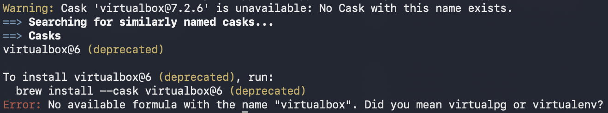

# Verslag: Opdracht 1 - Package Manager & Markdown

> Naam verslaggever: Deyssi Vedzijeva
## Beschrijving

We moesten leren werken met de package manager van ons besturingssysteem om het beheren en downloaden van software sneller en efficiënter te laten verlopen. Bovendien is het ook de bedoeling dat we leren werken met Markdown om documentatie in de toekomst te vergemakkelijken.

## Antwoorden op de vragen in de opdracht

### Vraag 1 - De map/directory waar we ons nu bevinden, wordt getoond. Wat is de naam van deze directory?

(Deyssi) Je komt standaard in de home directory terecht. (~)

(Louis)  System32, dit is de Systeemmap.

(Silas) System32

(Jonas) System32

(Alpay) System32

### Vraag 2 - In welke directory heb jij het script bewaard?

(Deyssi) In /Users/deyssi/Desktop/MT1 SEM II/SEL SEM 2/opdracht-1/scripts/opdracht1/deyssi/installatie.sh

(Louis)  In C:\Users\louis\Documents\SELab\PowerShell_Scripts

(Silas)  In C:\Users\silas\Documents\SELab\opdracht1

(Jonas)  In C:\Users\jonas\OneDrive\Bureaublad\school 2025-2026\sem2\installatie.ps1

(Alpay)  In C:\Users\cakal\Downloads\Toegepaste Informatica 2025-2026 (Harde schijf)\2025-2026 Semester 2\System engineering lab\SELab Opdracht 1\Installatie.ps1

### Vraag 3 - In welke directory is het script bewaard uit het screenshot onder stap 6?

(Deyssi) In /Users/steven/Documents/SysEngLab/installatie.sh

(Louis)  In D:\Users\BertVV\Documents\HoGent\SELab

(Silas)  In D:\Users\BertVV\Documents\HoGent\SELab

(Jonas)  In D:\Users\BertVV\Documents\HoGent\SELab

(Alpay)  In D:\Users\BertVV\Documents\HoGent\SELab\Installatie.ps1

### Vraag 4 - Wat doen de opties `-e` en `--id` voor winget install?

`-e` of `--exact` kijkt of je invoer exact hetzelde is als wat je wenst te installeren. 

`--id` zorgt ervoor dat je invoer vergeleken wordt met de ID van de package die je wenst te installeren.

Door `-e` en `--id` te combineren zorg je ervoor dat het ID die je ingeeft exact hetzelfde moet zijn als het ID van de package die je wil installeren.

#### Bijkomende Opdracht Windows

| **Taak**                                                                | **Commando**                         |
| ----------------------------------------------------------------------- | ------------                         |
| Een lijst tonen van de software die nu geïnstalleerd is via WinGet      | `winget list`                        |
| Alle packages die nu geïnstalleerd zijn bijwerken tot de laatste versie | `winget upgrade --all`               |
| Via de console een package opzoeken                                     | `winget search <pakketid>`           |
| Een geïnstalleerd pakket verwijderen                                    | `winget uninstall -e --id <pakketid>`|

## Evaluatiecriteria

- [x] Je hebt een package manager voor jouw besturingssysteem geïnstalleerd.
- [x]  Je hebt een script (PowerShell of Bash, afhankelijk van je besturingssysteem) geschreven en gebruikt om de opgesomde applicaties te installeren.
- [x]  Je toont inzicht in de werking van een package manager en kan deze vlot kan gebruiken om basistaken uit te voeren.
- [x]  Er is een verslag gemaakt op basis van het template.
- [x]  Elk teamlid heeft de eigen cheat sheet aangevuld met nuttige commando's uit deze opdracht.
- [x]  Je hebt GitHub correct geconfigureerd op je toestel en je hebt de basiscommando's (via CLI) in je vingers.
- [x]  Er is een correct antwoord gegeven op de vragen die zijn aangeduid met een ❓.

## Problemen en oplossingen

### Probleem 1 - Korte beschrijving van het probleem

Bij het installeren van VirtualBox op macOS (Apple Silicon/M-chip) liep ik telkens tegen een foutmelding aan. Ik ben ervan uitgegaan dat dit kwam doordat VirtualBox niet volledig compatibel is met deze architectuur. Voor het vak Operating Systems (OS) moest ik om die reden ook UTM downloaden en gebruiken in plaats van VirtualBox. Hierdoor heb ik voor VirtualBox ook de 'pin'-functie niet kunnen testen. Zie foto hieronder om de exacte error die ik krijg.

### Probleem 2 - Korte beschrijving van het probleem

(Silas & Alpay) Wanneer ik `winget install` of `winget upgrade` probeerde uit te voeren kreeg ik in de console "Do you agree to all the source agreements terms?". Het probleem is dat de console bevroor en ik er niets in kon typen en dus ook niet kon akkoord gaan met de termen. De oplossing die ik gevonden heb is om eerst volgende commandos uit te voeren `--accept-source-agreements` en `--accept-package-agreements`. Hierna kon ik zonder problemen packages installeren en upgraden.

## Voorbereiding demo

Om duidelijk te laten zien dat we opdracht 1 succesvol hebben kunnen afronden, kunnen we dit stap voor stap reconstrueren. Eerst laten we elk zien (aangezien we verschillende OS'en hebben) dat de package manager op ons systeem staat. Hierna kunnen we eventueel een script schrijven om applicaties te installeren via Brew (WinGet), of het bestaande scriptbestand tonen; meer specifiek het installatie.sh bestand dat we moesten maken voor opdracht 1. Hierbij laten we ook duidelijk zien dat we de package manager vlot kunnen gebruiken.

Om de gebruikte commando's zeker niet te vergeten, hebben we deze elk in onze eigen cheat sheet gezet. In deze opdracht hebben we voornamelijk de commando's brew install en brew pin gebruikt, omdat er enkel verwacht werd dat we apps zouden downloaden via de terminal/PowerShell. Om ook vlot met elkaar te communiceren als groep, werd er een GitHub-repo gemaakt waarin dit verslagdocument werd gedeeld en waarheen telkens bepaalde wijzigingen werden gecommit.

## Reflecties

In het algemeen was de opdracht niet al te ingewikkeld. Het vergde wat tijd en opzoekwerk, maar het was zeker doenbaar. Om de uitbreiding van opdracht 1 te maken, was er wel extra opzoekwerk nodig over hoe je user-input kunt gebruiken om een bepaald commando uit te voeren.

## Bronnen
PWS Academy. (2022 10 februari). Using Homebrew to install and manage software on macOS

W3Schools. (z.d.). Bash conditions. Geraadpleegd op 22 februari 2026, van https://www.w3schools.com/bash/bash_conditions.php

Ryan’s Tutorials. (z.d.). Bash input. Geraadpleegd op 22 februari 2026, van https://ryanstutorials.net/bash-scripting-tutorial/bash-input.php

https://learn.microsoft.com/en-us/windows/package-manager/winget/install

